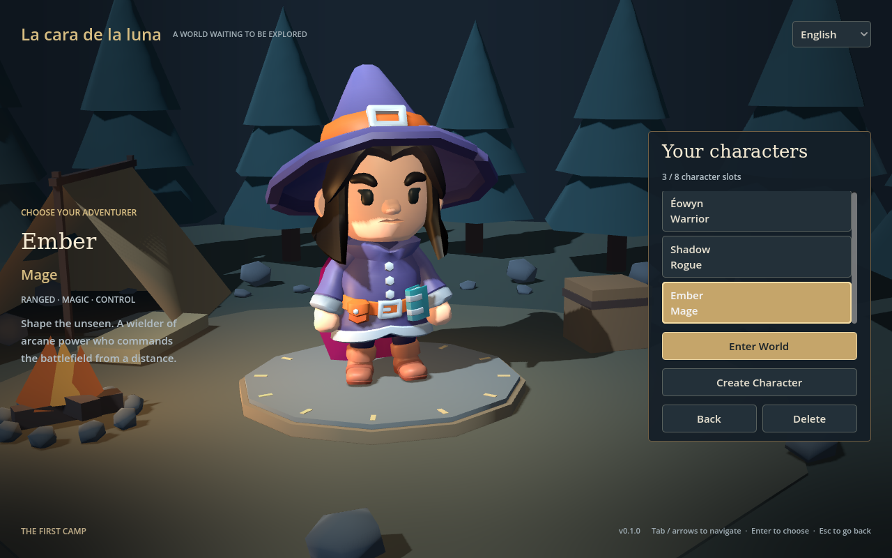

# La cara de la luna

A Godot 4 low poly PvE prototype with a fantasy camp, a local character roster,
and an animated character preview. Create a **Warrior**, **Rogue**, or **Mage**,
then enter the movement sandbox.



## Run

1. Import `project.godot` in standard Godot **4.7.2** (the tested version; .NET is not required).
2. Wait for the first asset and translation import.
3. Press **F5**. Choose **Play**, then **Create Character**.
4. Enter a name, choose a class, and select **Create**.
5. Choose **Enter World**. Move with **WASD / arrow keys**; press **Escape** to return to your roster.

```sh
godot --editor --path .
godot --path .
```

The title, roster, and creation screens share the same 3D camp. Mouse, Tab,
arrow keys, and Enter navigate the interface. The supported minimum window size
is 960 × 600; the reference layout is 1280 × 800.

## Characters and saves

- Eight local character slots, with the last selected character restored on launch.
- Names contain 2–20 characters after trimming. Unicode is supported; control
  characters and case-insensitive duplicates are rejected.
- Creation requires an explicit class choice. Cancel discards the draft.
- Delete requires confirmation; deleting the selected character selects its next neighbor.
- Classes have distinct KayKit models and share the pack's authored idle/walk animations.
  Combat, statistics, specializations, equipment selection, and appearance customization
  are deferred. All three currently share the same movement behavior.

Characters are saved in `user://characters.json`, in Godot's application user-data
directory (on Linux, usually `~/.local/share/godot/app_userdata/La cara de la luna/`). A temporary
file is written first and the previous primary file is copied to `characters.json.bak`
before replacement. Failed writes leave the in-memory roster unchanged.

An unreadable or unsupported save disables character changes and offers **Retry**;
it is never silently overwritten. To recover manually, close the game, copy the
damaged file somewhere safe, and restore a known-valid backup as `characters.json`.
Names and class IDs are saved; UI translations are resolved at display time.

## Languages

English is the default and fallback. Choose **English / Español** in the upper-right
corner of the menus or sandbox. The preference is saved separately in
`user://settings.cfg`. Switching languages preserves the character creation draft.

All player-facing text lives in `i18n/messages.csv`, using stable keys and `en` / `es`
columns. Godot imports the catalog into native translation resources. To add text,
add it to both columns and use its key through `tr()` or a translated scene label.
Keep `%s`, `%d`, and `%.1f` placeholders consistent across languages.

Code, technical identifiers, and documentation use English. Player-entered names
are displayed verbatim and never translated.

## Project structure

- `scenes/frontend.tscn`: project entry point; title, roster, and creation.
- `scripts/frontend.gd`: screen navigation, validation feedback, confirmations, and UI theme.
- `scripts/camp.gd`: original native-geometry camp, lighting, and animated preview.
- `scripts/character_store.gd`: versioned JSON storage and protected mutations.
- `data/classes/`: class resources with stable IDs, localization keys, and model references.
- `scripts/character_visual.gd`: shared KayKit skeleton and animation setup.
- `scripts/localization.gd`: language selection and preference persistence.
- `scenes/main.tscn`: walking sandbox; receives the selected character.
- `scenes/mannequin.tscn`: original Quaternius movement mannequin, retained as the
  standalone sandbox fallback when no character is selected.

The character store is an autoload with `create_character`, `select_character`,
`delete_character`, `selected_character`, and `load_characters` methods. Mutations
return success/failure; `error_key` supplies a localizable message on failure.
Persisted character records contain `id`, `name`, and `class_id`. The file also
contains a format version and selected character ID.

## Assets

- **KayKit: Adventurers Character Pack 2.0**, by Kay Lousberg, **CC0**. Uses Knight
  for Warrior, Rogue_Hooded for Rogue, and Mage for Mage. `Rig_Medium_General`
  supplies `Idle_A`; `Rig_Medium_MovementBasic` supplies `Walking_A`.
  These clips are copied into a common `Idle` / `Walk` animation library using
  their matching skeleton paths; no cross-rig retargeting is needed.
- **Universal Animation Library — Standard**, by Quaternius, **CC0 1.0**. The
  original mannequin still uses its non-root-motion model and clips.
- The camp is made from native Godot geometry and materials; no downloaded scenery is required.

Both packs retain their original license files. `.gdignore` files exclude unused
FBX directories from import while preserving source assets.

## Verification

```sh
godot --headless --editor --path . --import
godot --headless --path . --fixed-fps 60 --script res://tests/character_store_test.gd
godot --headless --path . --fixed-fps 60 --script res://tests/frontend_test.gd
godot --headless --path . --fixed-fps 60 --script res://tests/smoke.gd
```

Tests cover validation, persistence/reload, save protection, capacity, selection,
deletion, screen transitions, creation cancellation, both translation catalogs,
language persistence, world entry/return, and animated movement. They use isolated
temporary save paths and do not modify the normal roster or language preference.

## Releases and development

Download the Linux ZIP from [GitHub Releases](https://github.com/gstn-caruso/la-cara-de-la-luna/releases).
Source code and original game content are MIT licensed; see [LICENSE](LICENSE) and
[third-party notices](THIRD_PARTY_NOTICES.md) for the included asset and engine licenses.

Use feature branches and pull requests. Tests and a real Linux export run before
merge; Conventional Commit squash messages determine automatic SemVer releases
on `main`. See [CONTRIBUTING.md](CONTRIBUTING.md) for the exact release rules and
local build commands. The initial release is `v0.1.0`.

On first launch under the new title, existing characters and language settings
from the former prototype data directory are copied without deleting the originals
or replacing newer saves.
